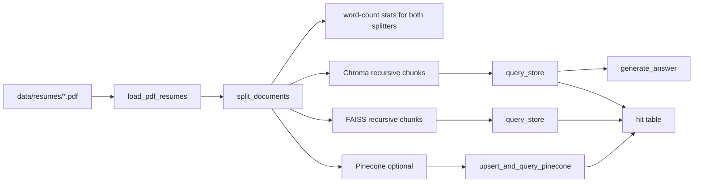

# Resume RAG

Retrieval pipeline for locally generated sample resume PDFs in `data/resumes`. Those PDFs and `data/ood/state_of_the_union.txt` are not in the repository; `scripts/seed_sample_pdfs.py` writes both before the demo. The loader reads sorted `*.pdf` files only, so `data/ood/state_of_the_union.txt` is not indexed. Each page is split twice, with a character splitter and a recursive splitter, and the run prints word-count stats for both. Only the recursive chunks are indexed, under deterministic chunk ids. Chroma and FAISS are queried with `query_store`. Pinecone is queried with `upsert_and_query_pinecone` when `PINECONE_API_KEY` is set, and skipped when it is not. `generate_answer` returns a `RAGAnswer` built from the Chroma hits. With `OPENAI_API_KEY` set, the summary comes from `gpt-4o-mini`. With that key unset and no injected client, the summary is extractive and there is one match per retrieved chunk. The demo completes with both API keys unset.



## Run the demo

The sample resume PDFs and `data/ood/state_of_the_union.txt` are not checked in. Generate both with the seeding script before you run the demo:

```bash
uv run python scripts/seed_sample_pdfs.py
uv run python scripts/demo.py
```

Run both commands from the repository root, in that order. The seeding script writes the sample PDFs to `data/resumes` and the out-of-domain paragraph to `data/ood/state_of_the_union.txt`. The demo requires that text file to be present, then confirms the loader did not index it. The demo is the recruiter path: one process loads the corpus, prints word-count stats for both splitters, upserts the recursive chunks into Chroma twice, queries Chroma and FAISS with `query_store`, skips Pinecone when no key is set, and prints `RAGAnswer` JSON from the Chroma hits. The default command succeeds with `PINECONE_API_KEY` and `OPENAI_API_KEY` unset.

Install dependencies once with `uv sync --extra dev`. `pip install -e ".[dev]"` is the equivalent install if you are not using uv.

A successful run prints:

- Page count, candidate count, and the sorted candidate ids, then `state_of_the_union.txt was not indexed`.
- Character and recursive splitter stats: chunk count, and min, max, and mean word counts.
- `chroma_count_after_first`, `chroma_count_after_second`, and `get_chroma_count`, equal to each other and to the recursive chunk count. The collection is deleted and recreated before those two upserts, including when `.chroma` already holds it.
- A hit table whose columns are store, rank, candidate, and score. Chroma and FAISS scores are printed as each store returns them. They are separate scales.
- `Pinecone skipped: PINECONE_API_KEY is not set.` when that key is unset. When the key is set, Pinecone rows are added to the same table.
- `RAGAnswer` JSON. With `OPENAI_API_KEY` unset, the summary is `Offline extractive summary (set OPENAI_API_KEY for LLM synthesis).` With the key set, the summary is the answer from `gpt-4o-mini`, unless `LLM_MODEL` overrides it.

The script resolves `data/resumes`, `data/ood`, and `.chroma` from the repository root. It indexes the recursive chunks. The query is `Python engineer with AWS and machine learning experience`. Chroma and FAISS each return 3 hits. Pinecone returns 3 hits when its key is set. The answer is generated from the Chroma hits.

If `data/resumes` is missing, `load_pdf_resumes` raises `FileNotFoundError`, the process exits non-zero, and no index is written. A failed check on the run exits non-zero as well. When Pinecone or OpenAI is configured and that call fails, the error propagates and the process exits non-zero.

## Engineering decisions

- **Deterministic ids.** Each chunk id is `{candidate_id}::{method}::chunk_{idx}`. Re-running a Chroma upsert keeps the collection count equal to the chunk count. When `add_documents` rejects an existing id, the helper uses the store upsert path so the row updates in place.
- **Candidate context.** Every chunk is prefixed with `[Candidate: {candidate_id}]` and the same id is stored on metadata, including chunks that no longer contain the original header page.
- **Shared resume shape.** The recursive splitter assumes every resume has the same format and shape as the seeded samples. It splits on line-start labels `Professional summary.`, `Selected work on`, `Experience.`, and `Education.`, in that layout. Those separators are specific to this corpus.
- **PDF-only corpus.** Sample resumes and `data/ood/state_of_the_union.txt` are local files generated by `scripts/seed_sample_pdfs.py` and are not committed. Ingestion never calls Kaggle and never reads the out-of-domain text file.
- **Structured answers.** `generate_answer` always returns a Pydantic `RAGAnswer`. When a key is present it asks OpenAI, using `gpt-4o-mini` unless `LLM_MODEL` is set. With no key and no injected client, it returns an extractive summary, empty skill lists, and one match per retrieved chunk whose quote is the first 200 characters of that chunk. Keys are loaded with `pydantic-settings` and are never written as literals.

Embeddings use `sentence-transformers/all-MiniLM-L6-v2` (384 dimensions). The first demo or notebook run downloads that model. The tests patch a local hash embedding and do not download it.

## Optional API keys

Copy `.env.example` to `.env` only when you want live Pinecone or OpenAI calls. The demo and the tests complete with those variables unset.

## Tests

```bash
uv run pytest tests/test_pipeline.py tests/test_demo.py
```

## Notebook walkthrough

`notebooks/vector_store_comparison.ipynb` is the longer walkthrough. It imports the package as `src` and runs five sections: setup and ingestion, splitter comparison, idempotent Chroma indexing, FAISS and optional Pinecone with query latency, and an end-to-end `RAGAnswer` from the Chroma hits.

```bash
uv run python -m ipykernel install --sys-prefix --name resume-rag
uv run pytest --nbmake notebooks/vector_store_comparison.ipynb
```

Run `scripts/seed_sample_pdfs.py` before this notebook as well. It writes the local sample PDFs and `data/ood/state_of_the_union.txt`, which are not in the repository.
